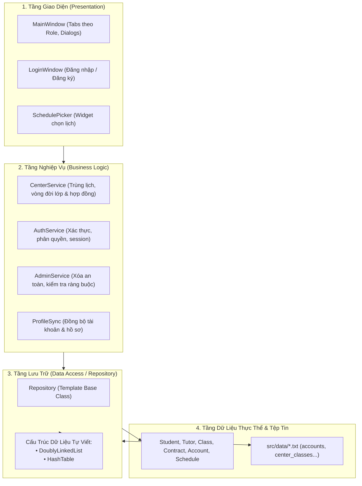

# 🎓 PBL2: Hệ Thống Quản Lý Trung Tâm Gia Sư (Tutor Center Management System)

> **Đồ án Cơ sở lập trình / Lập trình hướng đối tượng (OOP) & Cấu trúc dữ liệu và giải thuật (DSA)**  
> Khoa Công nghệ Thông tin – Trường Đại học Bách Khoa, Đại học Đà Nẵng (DUT).

---

## 📖 1. Giới Thiệu Đề Tài

Hệ thống Quản lý Trung tâm Gia sư là phần mềm máy tính hỗ trợ điều hành, kết nối giữa học viên, gia sư và ban quản trị trung tâm:
- **Học viên**: Dễ dàng tra cứu các ca học còn trống theo môn, đăng ký học và theo dõi hợp đồng gia sư.
- **Gia sư**: Mở các khung giờ dạy linh hoạt, phê duyệt/từ chối học sinh đăng ký, quản lý lớp dạy cá nhân.
- **Admin**: Quản lý hồ sơ, tài khoản, giám sát toàn bộ lớp học, hợp đồng và giải quyết xung đột lịch học.

Dự án được xây dựng bằng **C++17** kết hợp giao diện đồ họa **Qt 6**, áp dụng mô hình phân lớp chuẩn công nghiệp (**Layered Architecture**) và **tự xây dựng 100% các cấu trúc dữ liệu cốt lõi** (`DoublyLinkedList`, `HashTable`) mà không phụ thuộc vào STL container (`std::list`, `std::map`).

---

## ✨ 2. Các Tính Năng Chính (Phân Quyền - RBAC)

| Vai trò | Quyền hạn & Chức năng nổi bật |
| :--- | :--- |
| 🛡️ **Quản Trị Viên (Admin)** | • Quản lý toàn bộ danh sách Học viên, Gia sư, Tài khoản.<br/>• Cưỡng chế kết thúc hợp đồng khi có khiếu nại.<br/>• Xóa người dùng an toàn với cơ chế **xem trước tác động (Cascade Delete Impact)**.<br/>• Hỗ trợ đăng ký lớp hoặc mở ca hộ học sinh/gia sư. |
| 👨‍🏫 **Gia Sư (Tutor)** | • Mở ca dạy mới (tự động kiểm tra trùng giờ dạy của chính mình).<br/>• Xem danh sách học viên gửi yêu cầu đăng ký (`PENDING`).<br/>• **Phê duyệt** (tự động khởi tạo `Contract` mới) hoặc **Từ chối** ca học.<br/>• Xóa lớp trống chưa có học sinh đăng ký.<br/>• Gửi yêu cầu kết thúc hợp đồng kèm lý do. |
| 👨‍🎓 **Học Sinh (Student)** | • Tìm kiếm ca học khả dụng (`AVAILABLE`) theo môn học.<br/>• Đăng ký lớp (tự động kiểm tra trùng lịch học hiện tại).<br/>• Rút đăng ký lớp khi đang chờ duyệt (`PENDING`).<br/>• Theo dõi danh sách lớp học và hợp đồng cá nhân.<br/>• Đồng thuận kết thúc hợp đồng hoặc rút yêu cầu. |
| 👤 **Khách (Guest)** | • Xem danh sách các lớp học đang mở để tham khảo thông tin. |

---

## 🏛️ 3. Kiến Trúc Hệ Thống & Điểm Nhấn Kỹ Thuật



### 🎯 Điểm nhấn kỹ thuật & Thuật toán:
1. **Cấu trúc dữ liệu tự cài đặt (DSA)**:
   - `DoublyLinkedList<T>`: Danh sách liên kết đôi hỗ trợ duyệt, chèn, xóa $O(1)$ ở đầu/cuối.
   - `HashTable<K, V>`: Bảng băm giải quyết va chạm bằng Separate Chaining (mỗi bucket là 1 Doubly Linked List), tra cứu tức thì $O(1)$.
2. **Cơ chế lưu trữ kép (In-Memory Cache & File Sync)**:
   - Mỗi `Repository` kết hợp `DoublyLinkedList` (duyệt hiển thị) và `HashTable` (tìm theo ID $O(1)$).
   - Tự động nạp dữ liệu lúc khởi động và đồng bộ ngay xuống file văn bản phẳng (`.txt`) khi có thao tác thêm/sửa/xóa.
3. **Thuật toán kiểm tra trùng lịch học (Schedule Overlap)**:
   - Sử dụng **Bitmask** (`unsigned dayMask`) đại diện cho các thứ trong tuần (T2..CN).
   - Kiểm tra giao thoa thời gian (phút trong ngày): $\max(start_1, start_2) < \min(end_1, end_2)$ kết hợp phép `&` bitmask ngày.
4. **Kiểm thử tự động (Unit Test Suite)**:
   - Framework kiểm thử tự viết (`test_framework.h`, header-only, không phụ thuộc thư viện ngoài).
   - **39 test cases tự động** bao phủ toàn diện tính đúng đắn của Repository và Service.

---

## 📁 4. Cấu Trúc Thư Mục Dự Án

```text
PBL2/
├── assets/                     # Tài nguyên hình ảnh, logo, icon
├── build/                      # Thư mục build (CMake / Ninja)
├── plan/                       # Kế hoạch và tài liệu đề cương đồ án
├── src/
│   ├── code/                   # File mã nguồn thực thi (*.cpp)
│   │   ├── entities/           # Student.cpp, Tutor.cpp, Class.cpp, Schedule.cpp...
│   │   ├── helper/             # IdGenerator.cpp, Validator.cpp, RecordFile.cpp...
│   │   ├── repositories/       # AccountRepository.cpp, StudentRepository.cpp...
│   │   ├── services/           # CenterService.cpp, AuthService.cpp, AdminService.cpp...
│   │   ├── ui/                 # MainWindow.cpp, LoginWindow.cpp, SchedulePicker.cpp...
│   │   ├── main.cpp            # Console demo
│   │   └── main_gui.cpp        # Điểm khởi chạy ứng dụng GUI Qt
│   ├── data/                   # Dữ liệu lưu trữ dạng text (*.txt)
│   │   ├── accounts.txt        # Danh sách tài khoản đăng nhập
│   │   ├── center_classes.txt  # Danh sách lớp học
│   │   ├── center_contracts.txt# Danh sách hợp đồng gia sư
│   │   ├── center_students.txt # Danh sách hồ sơ học sinh
│   │   └── center_tutors.txt   # Danh sách hồ sơ gia sư
│   └── include/                # File tiêu đề header (*.h)
│       ├── dsa/                # DoublyLinkedList.h, HashTable.h
│       ├── entities/           # Class, Person, Student, Tutor, Contract, Account, Schedule
│       ├── helper/             # Validator, IdGenerator, PasswordHasher, RecordFile, StringUtils
│       ├── repositories/       # Repository<T> và các Repo con
│       ├── services/           # CenterService, AuthService, AdminService, ProfileSync...
│       └── ui/                 # MainWindow.h, LoginWindow.h, SchedulePicker.h...
├── tests/                      # Bộ Unit Test tự động (test_main.cpp, ServiceTest, RepoTest)
├── CMakeLists.txt              # Kịch bản build CMake
├── run_gui.bat                 # Script chạy nhanh ứng dụng GUI trên Windows
├── DSA_FLOW.md                 # Tài liệu chi tiết luồng hoạt động của 2 cấu trúc dữ liệu
├── BACKEND_FLOW.md             # Sơ đồ và luồng hoạt động chi tiết của các hàm Backend
└── README.md                   # Tài liệu hướng dẫn dự án
```

---

## 🚀 5. Hướng Dẫn Cài Đặt & Chạy Ứng Dụng

### Yêu Cầu Môi Trường (Prerequisites)
- **Hệ điều hành**: Windows 10/11 (hoặc Linux/macOS)
- **Trình biên dịch**: GCC / Clang hỗ trợ **C++17** (Khuyên dùng MSYS2 UCRT64 trên Windows)
- **Công cụ build**: CMake (>= 3.16), Ninja hoặc Make
- **Thư viện đồ họa**: **Qt 6** (Qt6 Core, Gui, Widgets)

---

### Cách 1: Biên dịch và chạy từ Terminal (PowerShell / Command Prompt)

1. **Thêm đường dẫn MSYS2 / MinGW vào biến môi trường (nếu dùng Windows UCRT64)**:
   ```powershell
   $env:PATH = "C:\msys64\ucrt64\bin;" + $env:PATH
   ```

2. **Cấu hình dự án bằng CMake**:
   ```bash
   cmake -S . -B build -G Ninja
   ```

3. **Biên dịch toàn bộ dự án**:
   ```bash
   cmake --build build
   ```

4. **Khởi chạy ứng dụng đồ họa**:
   ```powershell
   .\build\pbl2_gui.exe
   ```

---

### Cách 2: Chạy nhanh bằng file Batch (Windows)
Sau khi đã build xong lần đầu, bạn chỉ cần nhấp đúp vào:
```cmd
run_gui.bat
```

---

### Cách 3: Chạy Bộ Kiểm Thử Tự Động (Unit Tests)
Để chạy 39 bài kiểm thử logic Backend mà không cần mở GUI:
```bash
# 1. Bật cờ kiểm thử và build
cmake -S . -B build -G Ninja -DBUILD_TESTS=ON
cmake --build build

# 2. Chạy test
.\build\pbl2_tests.exe
```

---

## 🔑 6. Tài Khoản Đăng Nhập Mặc Định

Hệ thống có sẵn các tài khoản demo khởi tạo ban đầu để kiểm thử các vai trò:

| Tài khoản | Mật khẩu | Vai trò (Role) | Mô tả |
| :--- | :---: | :---: | :--- |
| **`admin`** | `admin123` | **Admin** | Quản trị viên tối cao, toàn quyền hệ thống |
| **`student`** | `123456` | **Student** | Tài khoản học sinh mẫu (`SV001` - Nguyễn Văn An) |
| **`DanhLe123`**| `123456` | **Tutor** | Tài khoản gia sư mẫu (`GS004` - Lê Minh Danh) |

> 💡 *Bạn cũng có thể bấm vào nút **"Đăng Ký"** ngay trên màn hình đăng nhập để tạo tài khoản Học sinh hoặc Gia sư mới.*

---

## 📚 7. Tài Liệu Kỹ Thuật Bổ Trợ Trong Repo

- **[DSA_FLOW.md](DSA_FLOW.md)**: Giải thích chi tiết cấu trúc `Node`, giải thuật băm chuỗi, giải quyết va chạm bucket và phân tích độ phức tạp thời gian $O(1)$ vs $O(N)$.
- **[BACKEND_FLOW.md](BACKEND_FLOW.md)**: Sơ đồ tương tác tuần tự (Sequence Diagram), vòng đời lớp học và hợp đồng, cơ chế lưu trữ kép của Repository dành cho người mới đọc code.

---

## 👥 8. Nhóm Tác Giả

- **Lê Minh Danh** 
- **Phạm Hoàng Vũ** 
- **Trường**: Đại học Bách Khoa – Đại học Đà Nẵng (DUT)
- **Học phần**: Đồ án Cơ sở lập trình / PBL2
